# chip-spec-diagram

半導体チップの仕様書に載せる図を作るハーネスです。Claude が `SKILL.md` の手順に沿って、状況に応じて質問し、図を描き進めます。

- **構想段階**: 質問して決定事項を少しずつ増やします。決まっていないことは「仮」「TBD」として描いて先へ進めます。
- **RTLあり**: RTL を解析して図を起こし、推定に自信がない部分だけを確認します。
- **物理面**: IPの実寸によるフロアプラン、ボード上のコネクタの位置から決めるチップIOの辺、draw.io への換算出力を扱います。

## 描ける図

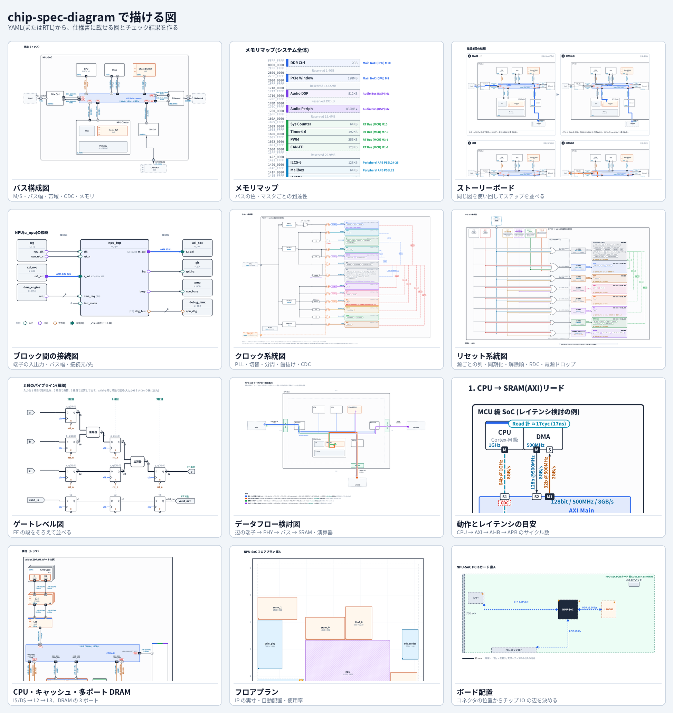

見本はすべて `examples/` のサンプルから作っています。`python3 scripts/gallery.py` で作り直せます。

| 図 | 手順 | 例 |
|---|---|---|
| [バス構成図](#バス構成図) | `diagrams/bus-architecture/GUIDE.md` | `examples/npu_soc.yaml` |
| [CPU・キャッシュ・多ポート DRAM](#cpuキャッシュ多ポート-dram) | `diagrams/bus-architecture/GUIDE.md` | `examples/multiport_dram.yaml` |
| [メモリマップ](#メモリマップ) | `diagrams/bus-architecture/GUIDE.md` | `examples/product_soc.yaml` |
| [動作とレイテンシの目安](#動作とレイテンシの目安) | `diagrams/bus-architecture/GUIDE.md` | `examples/latency_demo.yaml` |
| [ストーリーボード](#ストーリーボード) | `diagrams/storyboard/GUIDE.md` | `examples/npu_soc.yaml` |
| [ブロック間の接続図](#ブロック間の接続図) | `diagrams/block-interface/GUIDE.md` | `examples/interface_npu.yaml` |
| [クロック系統図](#クロック系統図) | `diagrams/clock-tree/GUIDE.md` | `examples/product_soc.yaml` |
| [クロック系統図(テストモード)](#クロック系統図テストモード) | `diagrams/clock-tree/GUIDE.md` | `examples/product_soc.yaml` |
| [リセット系統図](#リセット系統図) | `diagrams/reset-tree/GUIDE.md` | `examples/product_soc.yaml` |
| [ゲートレベル図](#ゲートレベル図) | `diagrams/gate-level/GUIDE.md` | `examples/gate/pipeline.yaml` |
| [ゲートレベル図(クロック切替)](#ゲートレベル図クロック切替) | `diagrams/gate-level/GUIDE.md` | `examples/gate/glitchfree_clkmux.yaml` |
| [データフロー検討図](#データフロー検討図) | `diagrams/dataflow-floorplan/GUIDE.md` | `examples/npu_soc.yaml` |
| [フロアプラン](#フロアプラン) | `diagrams/bus-architecture/GUIDE.md(G4)` | `examples/floorplan.yaml` |
| [ボード配置](#ボード配置) | `diagrams/bus-architecture/GUIDE.md(G4)` | `examples/board.yaml` |

### バス構成図

マスタ/スレーブ(M/S)・バス幅・クロック・帯域・CDC・SRAM の位置。バスの分割・バス同士の接続・APB・多ポート DRAM、到達性とループの検査。

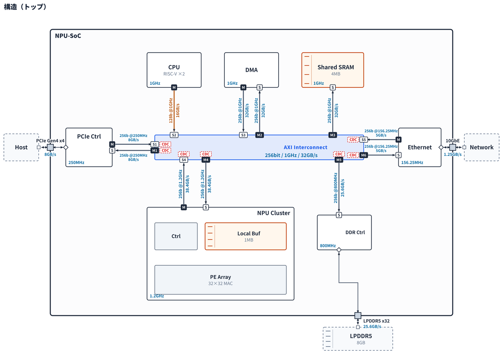

手順: `diagrams/bus-architecture/GUIDE.md` / 例: `examples/npu_soc.yaml`

### CPU・キャッシュ・多ポート DRAM

CPU 枠の中の I$/D$、L2 → L3 → バス。複数の AXI から DRAM コントローラの複数ポートへ。

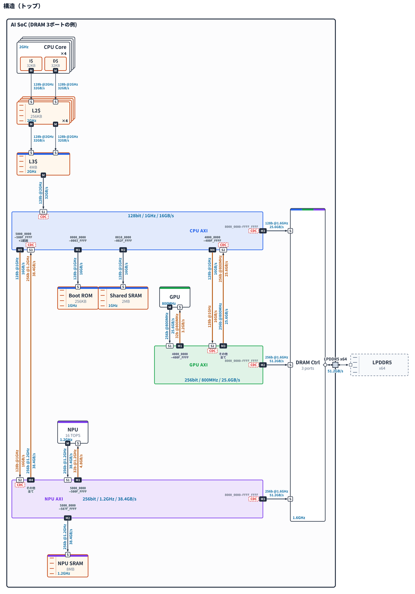

手順: `diagrams/bus-architecture/GUIDE.md` / 例: `examples/multiport_dram.yaml`

### メモリマップ

バス構成図と同じ色。マスタごとに全アドレスへ届くか、ループがないかを表にする。

手順: `diagrams/bus-architecture/GUIDE.md` / 例: `examples/product_soc.yaml`

### 動作とレイテンシの目安

CPU → AXI → AHB → APB の矢印と、到着・リードの戻りまでのサイクル数。

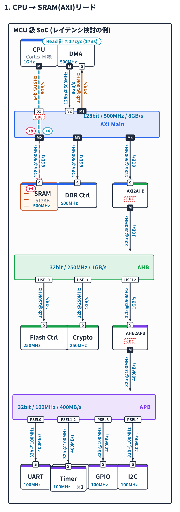

手順: `diagrams/bus-architecture/GUIDE.md` / 例: `examples/latency_demo.yaml`

### ストーリーボード

構成図を使い回し、ステップごとのコマを同じ縮尺で 1 枚に並べる。

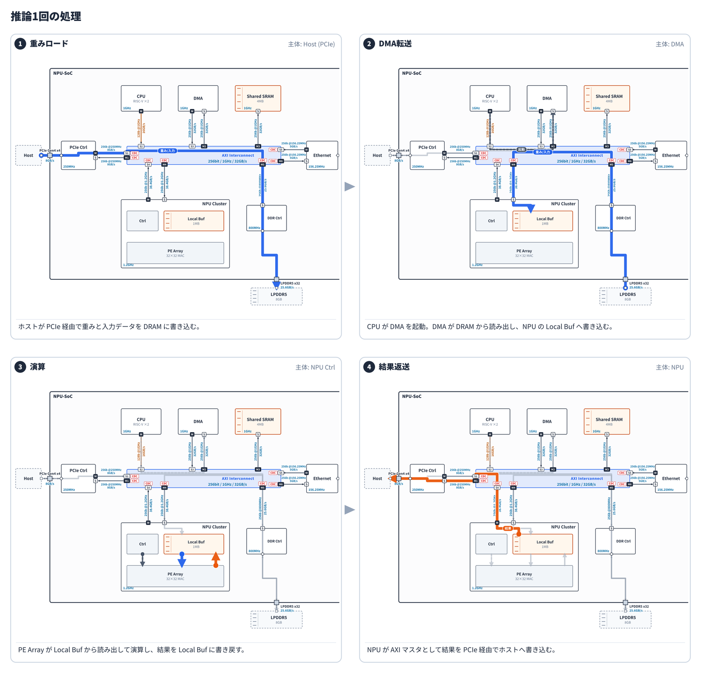

手順: `diagrams/storyboard/GUIDE.md` / 例: `examples/npu_soc.yaml`

### ブロック間の接続図

中心のブロックと接続元・接続先。端子の入出力・バス幅。RTL から起こせる。

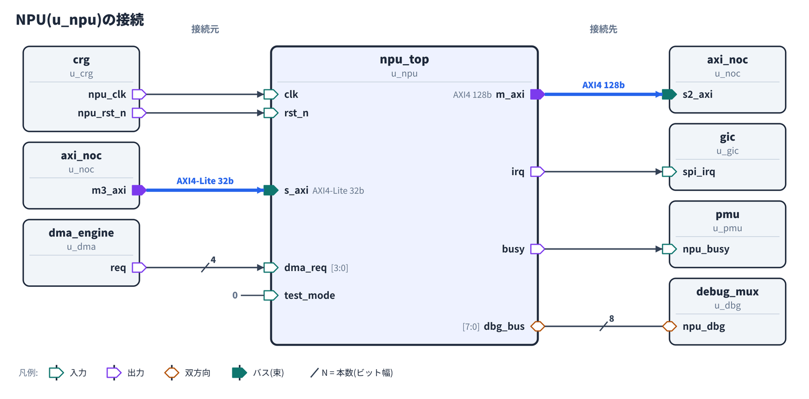

手順: `diagrams/block-interface/GUIDE.md` / 例: `examples/interface_npu.yaml`

### クロック系統図

源 → PLL → 切替 → 分周(レジスタ切替・歯抜け)→ ゲート → ドメイン。CDC と比率同期、SDC の下書き。

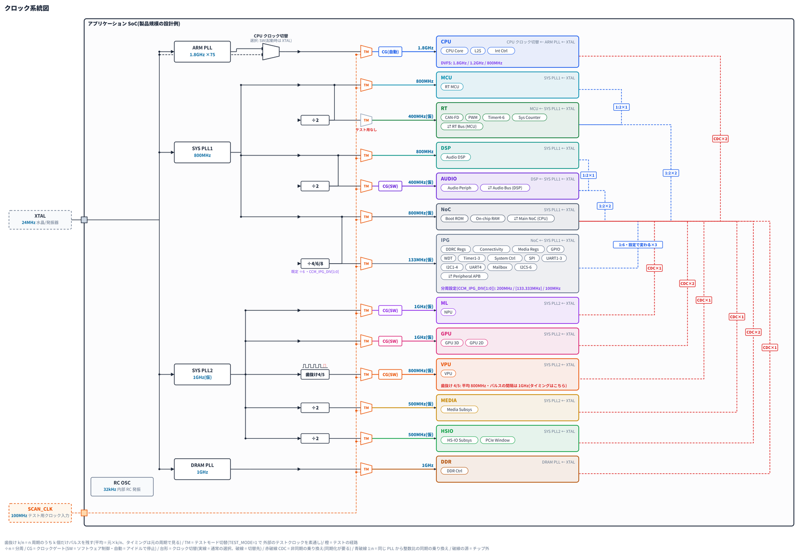

手順: `diagrams/clock-tree/GUIDE.md` / 例: `examples/product_soc.yaml`

### クロック系統図(テストモード)

テストモードで外部のテスト用クロックを素通しする経路。

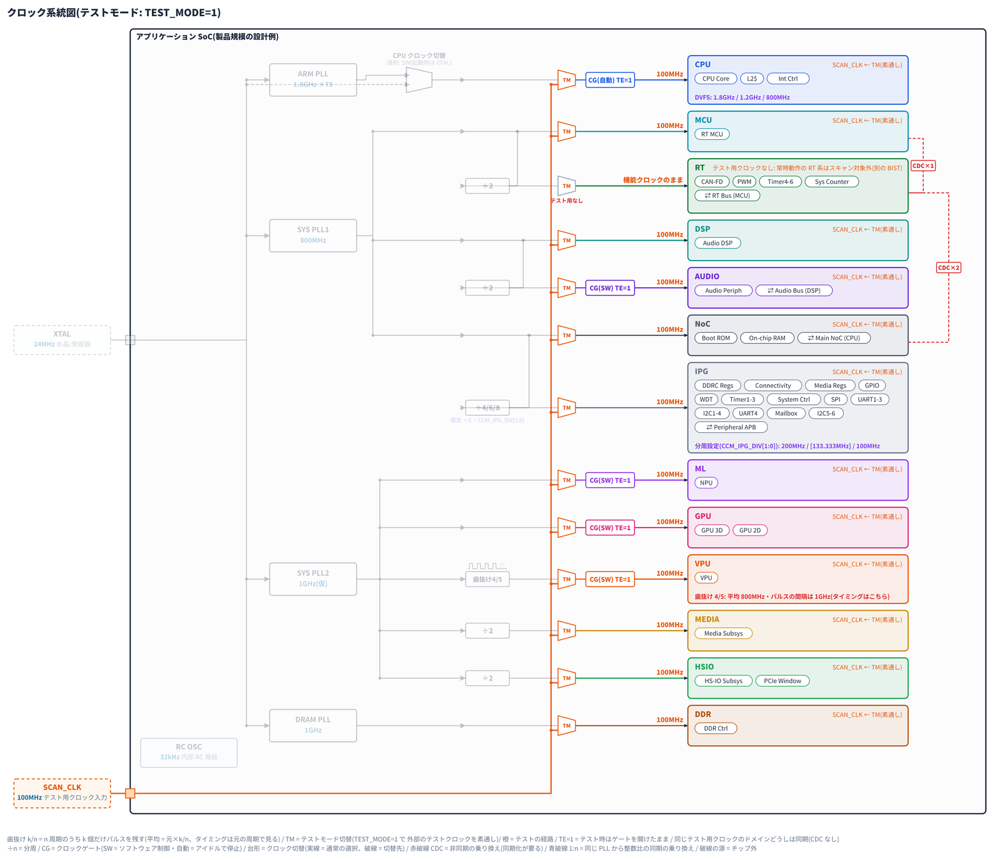

手順: `diagrams/clock-tree/GUIDE.md` / 例: `examples/product_soc.yaml`

### リセット系統図

リセット源ごとの列 → OR → 同期化 → ドメイン。非同期/同期と発行クロック、解除シーケンス、RDC、解除時の電源ドロップ。

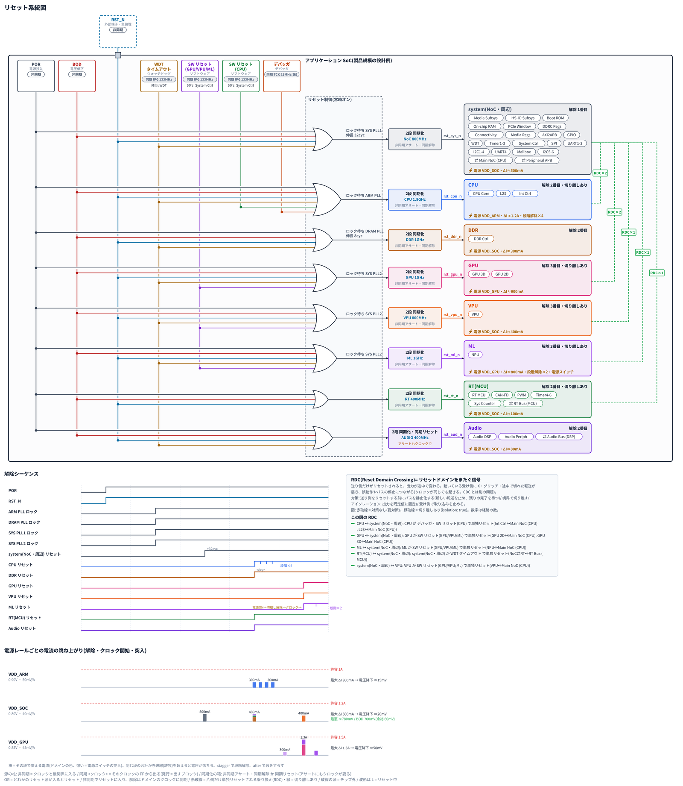

手順: `diagrams/reset-tree/GUIDE.md` / 例: `examples/product_soc.yaml`

### ゲートレベル図

IEEE の記号。FF を段ごとに等間隔・同じ高さに並べ、段数(レイテンシ)を読めるようにする。

手順: `diagrams/gate-level/GUIDE.md` / 例: `examples/gate/pipeline.yaml`

### ゲートレベル図(クロック切替)

クロックの配線は必要な時だけ。下の幹線から縦に上げて FF へ。

手順: `diagrams/gate-level/GUIDE.md` / 例: `examples/gate/glitchfree_clkmux.yaml`

### データフロー検討図

どの辺の端子から入り、PHY → バス → どの SRAM・演算器へ届くか。距離と帯域の表。

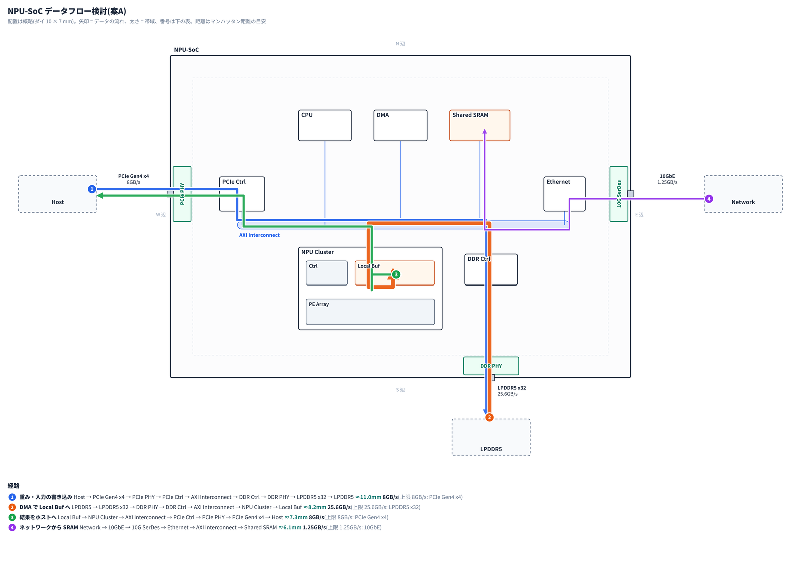

手順: `diagrams/dataflow-floorplan/GUIDE.md` / 例: `examples/npu_soc.yaml`

### フロアプラン

IP の実寸で配置を検討(見積もり・自動配置・重なりと使用率の確認)。

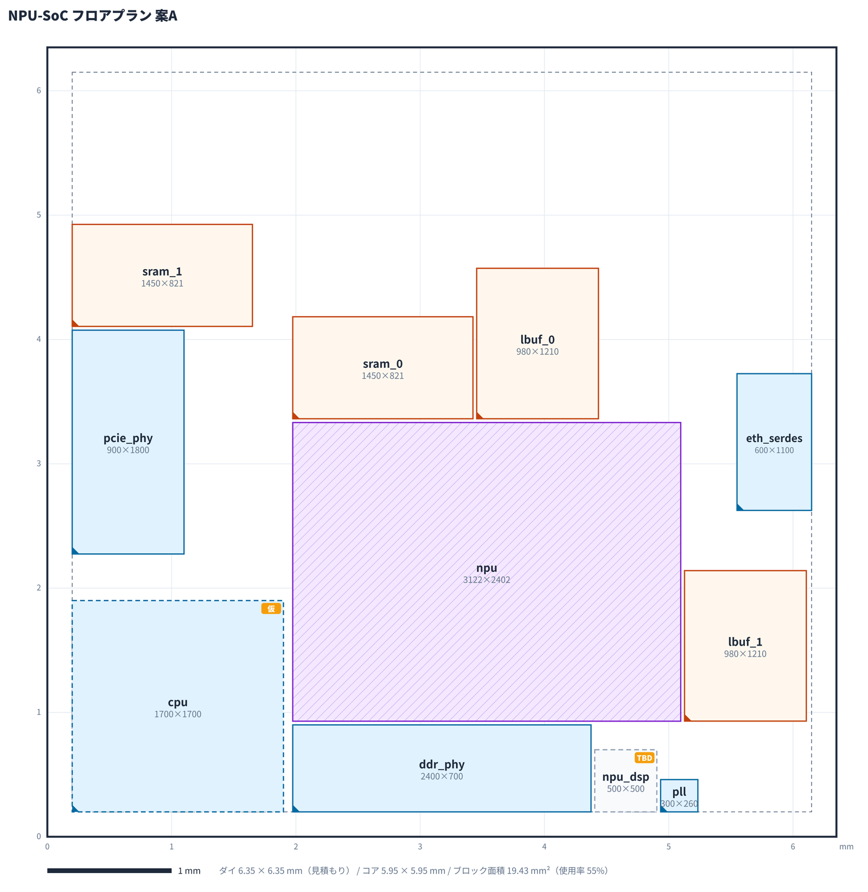

手順: `diagrams/bus-architecture/GUIDE.md(G4)` / 例: `examples/floorplan.yaml`

### ボード配置

ボード上のコネクタの位置から、チップ IO の辺を決める。

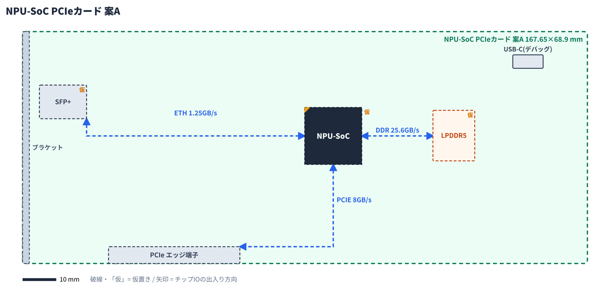

手順: `diagrams/bus-architecture/GUIDE.md(G4)` / 例: `examples/board.yaml`

`SKILL.md` は共通の手順(質問して決定事項を増やす・ルールの台帳・出す前の検査)と、図の種類ごとの手順への案内です。

## 使い方

- **Claude Code**: このフォルダを `~/.claude/skills/chip-spec-diagram/`（またはプロジェクトの `.claude/skills/`）に置きます。そのうえで「仕様書の図を作りたい」と頼むと、この手順が使われます。
- **Claude アプリ**: このフォルダを zip にし、設定のスキル画面からアップロードします。
- **必要なもの**: python3 と PyYAML。PNG 出力には rsvg-convert または cairosvg も必要です。

## スクリプト

| スクリプト | 役割 |
|---|---|
| `decisions.py` | 決定事項ログ（質問キュー・決定/仮決め/未決・仕様書用の表） |
| `rtl_scan.py` | Verilog/SV の解析（階層・ポート・接続） |
| `rtl2spec.py` | RTL から図YAMLへの変換（AXI/APB/AHB/メモリIF、M/S、バス、メモリ、SDCクロックを推定） |
| `chipdiag.py` | 描画（自動配置・構造/グループ/ステップ/詳細図・lint・SVG/PNG） |
| `layout.py` | 自動配置（バスの上下・左右、SRAMを利用ブロックの隣に置く） |
| `viewer.py` | レビュー用HTML（ステップ・グループ・階層・注記の切替、決定事項表、フロアプラン、ボード） |
| `drawio.py` | draw.io 出力（ステップ・グループをレイヤに分ける） |
| `ip_size.py` | LEF/Liberty/CSV からIPの寸法を取得 |
| `floorplan.py` | 実寸フロアプラン（見積もり・自動配置・重なり/使用率チェック・draw.io換算） |
| `clocktree.py` | クロック系統図(源→PLL→MUX→分周→ゲート→ドメイン、歯抜け・切り替え分周・テストモード、周波数の検算、CDC と比率同期、SDC の下書き) |
| `rules.py` | 作図ルール台帳（指摘をルールとして追加、出す前のチェックリスト、自動化されていないルールの一覧） |
| `board.py` | ボード配置とIOの辺の推奨、論理図・フロアプランとの突き合わせ |
| `resettree.py` | リセット系統図(源・OR・同期化・ドメイン・解除シーケンス・RDC のチェック) |
| `gatediag.py` | ゲートレベル図(標準記号で自動配置・配線、構造記述ネットリストの読み込み、未接続・ループ・ゲーテッドクロック・CDC のチェック) |
| `dataflowfp.py` | データフロー検討図(フロアプラン風の配置に、辺の端子 → PHY → バス → 行き先の流れ、距離・帯域の表) |
| `gallery.py` | README の図の見本を作り直す(全種類をサンプルから描き、一覧画像と個別画像を `docs/gallery/` に置く) |
| `storyboard.py` | 動作説明のストーリーボード(構成図を使い回し、ステップごとのコマを 1 枚に並べる) |
| `ifdiag.py` | ブロック間の接続図(YAML または RTL から。AXI/APB の束ね、lint、SVG/PNG/draw.io) |
| `memmap.py` `reach.py` `addrmap.py` | メモリマップの図と表、マスタごとの到達性・ループの検査 |
| `latency.py` | アクセス経路のレイテンシ目安(バス・ブリッジ・CDC・キャッシュ) |

`rules/style_rules.yaml` は作図ルールの台帳です。図への指摘をここに一般化して足していくことで、ハーネスが育ちます。

`examples/` にはサンプルが入っています（RTL、SDC、LEF/Liberty、論理図・フロアプラン・ボードのYAML）。
